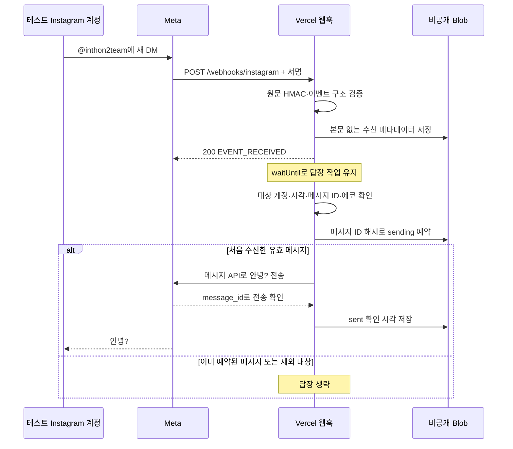

# Instagram DM ‘안녕?’ 테스트 인수인계

> 2026-10-31 배포 확인: 고정 도메인 HTTPS, challenge 검증, 잘못된 토큰·서명 거부, 서명된 빈 이벤트 저장, 클라우드 로그인 시작·보안 쿠키·재사용/쿠키 누락 거부를 확인했습니다. 현재 실제 DM 재테스트는 **Meta 계정 연결 복구 중**입니다. 기존 토큰의 계정 조회가 오류 100/33을 반환하며, 사용자가 보낸 새 DM은 클라우드에 도착하지 않았습니다. 토큰 자체의 유효성과 메시지 권한은 확인했습니다. 최신 리디렉션 URL 등록 후에도 Facebook 경로의 계정 선택 목록이 비어 있고, Instagram 직접 로그인에서는 앱 접근 제한 문구가 보고됐습니다. 앱 콘솔에는 필수 조치가 없고 게시되지 않은 상태이며, 대상 계정의 테스터 역할과 포트폴리오 연결을 확인 중입니다. 계정이 삭제됐다고 확정한 상태는 아닙니다. 아래 테스트는 계정 재연결·메시지 구독 복구 후 진행하세요.

## 팀원이 바로 테스트하기

이 단계에서는 서버를 로컬에서 띄우거나 토큰을 받을 필요가 없습니다.

1. `https://inthon.yeoziphab.com/health`가 `ok`를 반환하는지 확인합니다.
2. 기존 테스트에 사용한 다른 Instagram 계정에서 `@inthon2team`으로 **새 DM**을 보냅니다.
3. 정확히 `안녕?`이라는 답장이 한 번 오는지 확인합니다.
4. 다른 문구로 한 번 더 보내 새 메시지마다 답장하는지 확인합니다.
5. 테스트 시각(KST), 보낸 메시지 수, 받은 답장 수, 성공 여부를 기록합니다. 토큰·발신자 ID·개인 대화 본문은 이슈에 올리지 않습니다.

앱은 개발 단계입니다. 새 팀원의 계정으로 테스트가 안 되면 Meta의 앱 역할·테스트 계정·권한 범위를 먼저 확인합니다. 기존에 통과한 계정을 기준으로 비교하세요. 일반 사용자 공개가 완료된 상태는 아닙니다.

## 현재 구성

| 항목 | 값 |
| --- | --- |
| 저장소 | `https://github.com/iamnotfemale/2026InThon` (비공개) |
| 운영 프로젝트 | Vercel `yeoseungmins-projects/inthon` |
| 고정 주소 | `https://inthon.yeoziphab.com` |
| 상태 확인 | `GET /health` |
| Meta 웹훅 | `GET, POST /webhooks/instagram` |
| 클라우드 로그인 콜백 | `https://inthon.yeoziphab.com/auth/instagram/callback` |
| DNS 반영 전 사용할 기본 주소 | `https://inthon-pi.vercel.app` (같은 Vercel 프로젝트) |
| 테스트 대상 | `@inthon2team` / `17841414630453998` |
| Meta 앱 | `2418018855613539` |
| 로그인 구성 | `2085773485459248` |
| Graph API | `https://graph.facebook.com/v26.0` |
| 계정 권한 | `instagram_basic`, `instagram_manage_messages` + 기본 `public_profile` |
| 웹훅 구독 | `messages` |
| 클라우드 기록 | Vercel의 비공개 Blob `inthon-dm-state` |

Cloudflare는 `inthon`의 DNS 주소를 Vercel에 연결합니다. PC와 ngrok을 켜 두지 않아도 운영 웹훅이 실행됩니다. 도메인 루트에는 아직 대시보드가 없으므로 `/health`로 확인하세요.

## 수신부터 답장까지



- Meta 검증 GET은 동일한 검증 토큰일 때만 `hub.challenge`를 그대로 반환합니다.
- POST는 요청의 원문 바이트로 `X-Hub-Signature-256`을 검사합니다. 서명 없는 요청은 거부합니다.
- `instagram` 이벤트의 `messaging`과 `changes[field=messages]` 두 형식을 처리합니다.
- 자기 메시지·에코·삭제 메시지·다른 수신 계정·잘못된 ID·24시간을 넘긴 이벤트는 답장하지 않습니다.
- 예약은 덮어쓰기 없이 저장합니다. 다른 함수 인스턴스나 재배포 후에도 같은 해시가 있으면 보내지 않습니다.
- **예약 후 장애가 나거나 전송 결과가 불명확하면 자동 재시도하지 않습니다.** 중복 전송을 피하기 위한 현재 테스트 동작입니다. 예약과 전송을 하나의 트랜잭션으로 묶은 정확히 한 번 전송 보장은 아닙니다.

## 인증과 비밀값

현재 운영 봇은 이미 승인받은 `@inthon2team` 토큰을 Vercel의 **Production 환경변수**로 사용합니다. Preview에는 Meta 자격증명을 넣지 않습니다.

| 환경변수 | 용도 |
| --- | --- |
| `META_APP_SECRET` | 실제 수신 서명 검증용 앱 시크릿 |
| `META_ACCESS_TOKEN` | 초기 토큰. 클라우드 재승인 토큰이 저장되면 최신 암호화 토큰을 우선 사용 |
| `META_VERIFY_TOKEN` | Meta와 서버가 공유하는 웹훅 검증 토큰 |
| `PUBLIC_URL` | `https://inthon.yeoziphab.com` |
| `BLOB_READ_WRITE_TOKEN` | 비공개 상태 저장소 접근, Vercel 연결로 생성 |

토큰·시크릿은 GitHub, 브라우저용 환경변수, 이슈, 채팅에 넣지 않습니다. Vercel 환경변수를 변경한 뒤에는 재배포가 필요합니다.

**클라우드 로그인은 운영자가 기존 `@inthon2team`을 다시 연결하는 용도입니다.** 새 사용자가 각자의 Instagram 계정을 등록하는 기능은 아직 없습니다.

운영자 재연결 순서:

1. 기존 앱 시크릿을 보관한 Windows PC에서 `start.ps1`로 로컬 관리 화면을 엽니다.
2. **운영 서버에서 Instagram 다시 연결하기**를 누릅니다. 로컬 CSRF 검사를 거쳐 10분 동안 유효한 일회용 로그인 티켓을 만듭니다.
3. `inthon-pi.vercel.app`에서 Meta로 이동합니다. 이 기본 주소는 새 DNS를 아직 찾지 못하는 네트워크에서도 동일 서버로 접속하기 위한 주소입니다.
4. `@inthon2team`만 선택해 기존 기본·메시지 권한을 승인합니다. Meta의 자산 목록이 비어 있다면 앱 역할 목록과 별도로 비즈니스 포트폴리오의 Instagram 연결을 확인합니다.
5. 클라우드 콜백은 HMAC 서명된 state·브라우저 쿠키·만료·일회성·콜백 주소를 검증한 뒤 코드를 교환합니다. 대상 계정을 조회하고 `messages`를 구독·조회한 뒤에만 토큰을 저장합니다.
6. 토큰은 앱 시크릿에서 유도한 키로 AES-256-GCM 암호화해 비공개 Blob에 새 버전으로 저장합니다. 답장 함수는 최신 버전을 읽으므로 토큰 재발급만으로 재배포할 필요가 없습니다. 새 DM으로 실제 응답을 확인합니다.

Meta에는 고정 도메인과 기본 Vercel 주소의 `/auth/instagram/callback` 두 주소를 모두 등록했습니다. 서버는 이 두 호스트만 로그인에 허용하며 로그인 시작 때 선택한 콜백을 state에 묶어 검증합니다. 단순히 Meta가 생성한 정적 로그인 URL을 열면 서버의 state·쿠키가 없으므로 실패합니다. 반드시 운영 도구에서 시작하세요.

기존 로컬 전용 로그인 버튼은 ngrok 콜백을 사용하며 **로컬 DPAPI 토큰만** 바꿉니다. 운영 재연결 버튼과 구분하세요. 앱 시크릿을 교체하면 암호화된 운영 토큰도 새 키로 다시 저장하는 별도 복구가 필요합니다.

## 기록 확인과 문제 해결

Vercel 프로젝트의 Storage에서 비공개 Blob을 확인할 수 있습니다.

- `dm/receipts/<uuid>.json`: 수신 시각, 메시지 수, entry 수. 에코·샘플 이벤트도 포함됩니다.
- `dm/replies/<sha256>/sending.json`: 전송 전에 확보한 예약 시각.
- `dm/replies/<sha256>/sent.json`: Meta가 `message_id`를 반환한 뒤의 확인 시각.
- `dm/oauth/tickets/`, `dm/oauth/states/`: 로그인 요청 재사용 방지용 임의 nonce·사용 시각.
- `dm/credentials/<timestamp-random>.json`: 암호화된 운영 토큰 버전. 평문 토큰을 담지 않습니다.

수신·답장 기록에 본문·발신자 ID·원문 메시지 ID·릴스 URL·토큰을 넣지 않습니다. 토큰은 위의 별도 암호화 영역에만 저장합니다. `sending`만 있고 `sent`가 없으면 실패 또는 결과 미확인 상태입니다. 이 파일을 지우거나 이벤트를 수동 재전송해 재시도하지 말고 전송 여부부터 확인하세요. Blob은 현재 테스트의 메타데이터·운영 인증정보 저장소이며 사용자 기록 조회용 DB가 아닙니다. 자동 정리 기능은 아직 없고 저장소 사용량 제한에 도달하면 수신 저장에 실패할 수 있습니다.

| 증상 | 확인 순서 |
| --- | --- |
| `/health`가 503 | Vercel Production 환경변수, Blob 연결, 최신 배포 확인 |
| 도메인이 열리지 않음 | Cloudflare `A inthon → 76.76.21.21`(DNS only), Vercel 도메인·인증서 확인. 새 DNS의 이전 조회 실패가 잠시 캐시될 수 있음 |
| 웹훅 검증 실패 | 경로, 검증 토큰 일치, 200 challenge 응답 확인 |
| 수신 기록 없음 | Meta 콜백 URL, `messages` 필드, 계정별 메시지 구독, 테스트 계정 확인 |
| 수신은 있지만 답장 없음 | 본인/에코/오래된 이벤트인지, 토큰 유효성, 메시지 권한, 예약·전송 상태 확인 |
| 재배포 후 같은 DM에 답장이 안 옴 | 정상 중복 방지 동작. 새 DM으로 테스트 |

Meta 대시보드 샘플 성공과 실제 다른 계정에서 보낸 DM 성공은 구분해서 기록합니다.

## 코드 수정과 배포

```sh
git clone https://github.com/iamnotfemale/2026InThon.git
cd 2026InThon
npm ci
npm test
```

저장소 접근 권한이 필요합니다. 단위 테스트에는 실제 토큰이나 DM이 필요하지 않습니다. Windows에서는 DPAPI 암호화 테스트도 실행하고, Linux에서는 해당 테스트만 건너뜁니다.

| 파일 | 담당 기능 |
| --- | --- |
| `server.mjs` | 서명·검증·수신·제외 조건·‘안녕?’ 전송, 로컬 OAuth/관리 화면 |
| `api/instagram.mjs` | 운영 경로 제한, 환경변수 설정, Vercel `waitUntil` 연결 |
| `cloud-state.mjs` | 비공개 수신 기록, 함수 인스턴스 사이의 예약·전송 확인 |
| `cloud-auth.mjs`, `oauth-state.mjs` | 운영 계정 재연결, state·쿠키·재사용 검증, 토큰 암호화·로딩 |
| `vercel.json` | 상태·웹훅·운영 OAuth 경로와 함수 실행 제한 |
| `server.test.mjs`, `cloud-state.test.mjs` | 자동 답장·보안·저장 오류·동시 수신 테스트 |
| `.github/workflows/test.yml` | Windows/Ubuntu 자동 테스트 |

GitHub가 Vercel 프로젝트에 연결되어 있습니다. `main` 변경은 운영 배포에 영향을 주므로 브랜치에서 수정하고 CI를 확인한 뒤 합칩니다. 서버가 하나의 Meta 앱을 공유하므로 테스트용 별도 ngrok 서버로 운영 콜백을 임의 교체하지 않습니다.

## Supabase 담당 팀원에게 전달할 경계

지금은 Supabase 프로젝트·테이블·개인 계정 연결·DM/릴스 보관을 만들지 않았습니다. 현재 원문은 요청 처리 중 메모리에만 존재하며, 과거 대화를 조회할 API도 없습니다.

팀원이 Supabase 스키마를 준비하면 `record(receipt)`, `reserveReply(key)`, `replyRecord(entry)`를 새 저장소에 연결할 수 있습니다. 특히 `reserveReply`는 고유 제약 등으로 **여러 함수 인스턴스 중 한 곳만 true**를 받도록 해야 합니다. 단순 조회 후 삽입으로 바꾸면 경쟁 상태에서 중복 답장이 생길 수 있습니다.

대시보드 사용자와 Instagram 발신자 연결, 원문·첨부 저장 형식, 보관·삭제 기간과 본인 기록 조회 권한은 해당 담당자가 합의해서 구현합니다. 팩트체크·근거 검색·영상 분석·개인화는 이 테스트에 포함되지 않습니다.

공식 참고: [Meta 통합 로그인](https://developers.facebook.com/documentation/instagram-platform/instagram-api-with-unified-login), [Vercel waitUntil](https://vercel.com/docs/functions/functions-api-reference/vercel-functions-package), [Vercel Blob](https://vercel.com/docs/vercel-blob).
