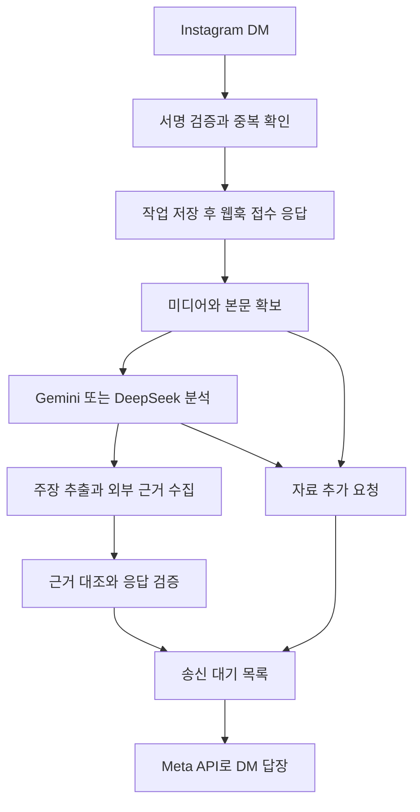

# Instagram DM 멀티모달 팩트체크 MVP 명세서

## 제품 목표와 검증 가설

**사용자가 Instagram DM으로 카드뉴스·릴스·이미지·영상·본문을 보내면, Gemini 또는 DeepSeek API가 내용을 분석하고 핵심 사실 주장을 외부 근거와 대조해 출처 링크와 함께 답장한다.**

작성 기준은 2026년 10월 31일이다. 미디어 분석을 MVP의 핵심 경로로 삼는 것은 사용자 결정이다. 아래의 모델 기본안, 입력 제한, 성과 목표, 보관 기간은 개발과 파일럿을 위한 제안값이며 아직 측정된 성과나 확정된 운영 정책이 아니다.

검증할 가설은 다음과 같다.

- 사용자는 별도 앱에서 검색하기보다 Instagram의 공유·DM으로 의심스러운 정보를 보낸다.
- 이미지·영상·본문에서 자신이 궁금했던 주장을 정확히 짚어주면 결과를 읽는다.
- 결론과 함께 실제 연구·공식 발표·보도 링크를 제공하면 내용을 이해하거나 판단하는 데 도움이 된다.
- 한 번의 체험 이후에도 새로운 콘텐츠를 자발적으로 다시 보낸다.

첫 버전은 한국어 응답, 1대1 DM, 요청당 핵심 주장 한 개에 집중한다. 영어 자료도 근거로 사용할 수 있다. 콘텐츠 안의 다른 주장까지 검증한 것처럼 전체 게시물에 진위 등급을 붙이지 않는다. 취향 추천·개인화 피드는 후속 범위다.

## 참고 서비스와 이번 제품의 범위

| 항목 | 참고한 흐름 | 이번 MVP의 결정 |
| --- | --- | --- |
| Stashr | 게시물·릴스를 DM으로 공유하고 저장된 내용을 다시 찾는 방식 | Instagram에서 공유하는 입력 경험을 참고한다 |
| 팩트체크 결과 | 주장과 근거를 연결해 같은 채팅에서 확인하는 방식 | 핵심 주장, 판단, 이유, 출처, 확인 시점을 반환한다 |
| 개인화 | 개인이 저장한 정보와 이용 맥락을 활용할 수 있는 확장 방향 | 이번에는 취향을 학습하거나 추천하지 않는다 |

Stashr의 공개 소개는 미디어 이해·저장·검색을 중심으로 한다. /app에는 Memories, Map, Ask와 링크 저장 흐름이 있다. 이 기능 소개를 우리 서비스의 미디어 접근 가능성이나 정확도에 대한 증거로 사용하지 않는다. [Stashr 소개](https://stashrai.com/) · [웹 앱](https://stashrai.com/app)

DM으로 릴스를 받아 근거 링크를 반환한다고 소개하는 서비스도 이미 있다. 따라서 파일럿은 기능의 새로움보다 한국어 콘텐츠에서의 입력 확보율, 근거 품질과 재사용을 검증해야 한다. [checkthis 공개 소개](https://checkthis.chat/)

**제외 범위:** 저장 라이브러리·지도·웹 사용자 대시보드·추천 피드·자동 취향 추론·여러 SNS 연동·결제·장문 대화형 리서치·딥페이크 진위 판별·개인의 진단이나 투자·법률 행동 권고. 일반 뉴스에 포함된 검증 가능한 사실은 다룰 수 있지만 개인 행동 처방으로 확장하지 않는다.

## 현재 구현과 추가 개발 범위

프로젝트 위치는 D:\\2026\\2026InThon이다. 현재 코드를 읽고 기존 실행 기록과 대조한 기준이다.

| 구성 | 확인된 현재 상태 | 팩트체크 MVP에 필요한 변경 |
| --- | --- | --- |
| Instagram 연결 | @inthon2team으로 실제 DM 수신과 고정 답장 안녕? 검증 완료 | 같은 채널과 권한을 재사용 |
| 인증 | Meta Unified Login, Graph API v26.0, 토큰 DPAPI 암호화 | 모델·검색 API 키도 서버에서 보호 |
| 웹훅 | HMAC 서명 검증, 에코 제외, 메시지 ID 해시 중복 방지 | 작업 저장 후 접수 응답, 처리 상태 관리 |
| 처리 | 웹훅 응답 후 메모리에서 고정 문구 전송 | 미디어 확보, 모델 분석, 검색·근거 검증, 결과 작성 |
| 복구 | 전송 실패·결과 미확인 건은 자동 재시도하지 않음 | 지속 저장하는 작업과 송신 대기 목록 |
| 데이터 | 본문·발신자 원문은 저장하지 않음 | 비동기 처리를 위한 최소 데이터와 삭제 정책 설계 |

고정 답장 성공은 이미지·영상 입력, AI 검증 품질, 장애 복구를 검증한 결과가 아니다. 이 명세 작성만으로 현재 실행 중인 봇의 응답을 변경하지 않는다.

Meta 앱 ID는 2418018855613539, 대상 계정 ID는 17841414630453998, 로그인 구성 ID는 2085773485459248이다. 시크릿·접근 토큰은 명세서에 포함하지 않는다.

## 모델 선택과 분석 구조

**기본 개발안은 Gemini로 이미지·영상·본문을 분석하고 응답을 작성하는 구조다.** DeepSeek는 실제 테스트 결과에 따라 선택할 수 있는 대안이다. 처음부터 두 공급자를 모두 운영하거나 자동 전환하는 기능은 만들지 않는다.

| 기능 | Gemini API | DeepSeek API | 명세에 반영할 조건 |
| --- | --- | --- | --- |
| 이미지와 본문 분석 | 멀티모달 입력 사용 | 현재 공식 Vision 문서에서 deepseek-flash의 이미지·텍스트 입력 확인 | 카드뉴스의 숫자·부정어·작은 글씨를 평가 |
| 영상과 음성 분석 | 공식 영상 이해 문서에서 시각·음성 처리와 시각 구간 참조 확인 | 확인한 Vision·Responses 문서에서 네이티브 영상·음성 입력은 확인되지 않음 | DeepSeek 영상 경로는 프레임 추출과 별도 음성 전사 검증 필요 |
| 외부 근거 탐색 | Google Search grounding 사용 가능 | 공식 Search & Fetch API 존재 | 실제 원문 확인과 출처 검증은 서버의 완료 조건 |
| 모델의 결론 | 근거와 입력 범위에 따라 제한 | 동일한 판단 규칙 적용 | 공급자 변경이 진위 기준을 바꾸면 안 됨 |

이미지 지원을 이유로 DeepSeek가 영상 파일 전체를 직접 처리한다고 가정하지 않는다. Gemini가 영상을 분석할 수 있어도 Instagram의 임의 릴스 URL에서 영상을 자동으로 확보할 수 있다는 뜻은 아니다. 영상 샘플링으로 빠르게 지나가는 자막을 놓칠 수 있으므로 읽은 범위와 불확실성을 결과에 반영한다.

기본 경로는 **미디어 분석 → 구조화된 주장 → 외부 검색과 원문 확보 → 근거 대조 → DM 응답**이다. 하나의 요청에 전부 맡기기보다 단계별 결과를 남겨 입력 해석 실패와 근거 판단 실패를 구분한다. 모델의 내부 추론 전문은 저장하거나 사용자에게 노출할 필요가 없다.

[Gemini 영상 이해](https://ai.google.dev/gemini-api/docs/video-understanding) · [Gemini 검색 grounding](https://ai.google.dev/gemini-api/docs/google-search/) · [DeepSeek Vision](https://api-docs.deepseek.com/guides/vision/) · [DeepSeek Responses](https://api-docs.deepseek.com/api/create-response/) · [DeepSeek Search & Fetch](https://api-docs.deepseek.com/guides/search/)

## 입력 지원과 콘텐츠 확보

다음 제한은 MVP 자체의 제안값이며 공급자 API의 최대치를 뜻하지 않는다. 텍스트는 요청당 5천 자, 카드뉴스는 최대 5장, 영상은 최대 90초·50MB로 시작한다. 초과 입력은 분석 범위를 고르게 하며 말없이 뒷부분을 버리지 않는다.

| 입력 | 분석 대상 | 완료 조건 또는 대체 흐름 |
| --- | --- | --- |
| 카드뉴스·이미지 | 실제 확보한 이미지, 장별 순서, 화면 글자, 숫자, 출처 표기 | 읽기 어려운 핵심 부분은 확대 이미지나 텍스트 요청 |
| 릴스·영상 | 확보한 영상의 화면·자막·음성·확인한 구간 | 영상 확보 실패 시 파일·화면 캡처·핵심 주장 요청 |
| 게시물 본문 | 실제 확보한 캡션·본문과 사용자가 덧붙인 질문 | 캡션만 읽었다면 영상은 확인하지 않았음을 표시 |
| 기사 URL | 본문, 발행·수정 시점, 기사에서 인용한 원자료 | 제목·검색 요약만 있거나 유료벽이면 원문 요청 또는 판단 보류 |
| 직접 쓴 텍스트 | 검증할 문장과 명시된 시점·대상·지역 | 모호한 주장은 구체화 요청 |

공유 이벤트는 링크, 미디어 URL, 일부 메타데이터 중 무엇을 주는지 실제 계정에서 먼저 측정한다. 장별 전체 이미지나 음성이 항상 전달된다고 가정하지 않는다. 비공개·삭제·로그인 필요 콘텐츠는 접근 가능 여부를 그대로 안내한다. 사용자 쿠키·계정 비밀번호를 받아 로그인하거나 접근 제한을 우회하는 경로는 MVP에 넣지 않는다.

여러 DM을 자동으로 한 게시물이라고 추측해 섞지 않는다. 동일 공유물에 묶인 첨부만 한 요청으로 처리한다. 여러 장을 따로 보낸 경우에는 이전 요청에 추가하는지 한 번 확인한다.

**선행 통과 조건:** 텍스트·기사 URL·카드뉴스·릴스 공유·직접 영상 첨부를 유형별로 실제 수신하고, 전달 필드·다운로드 가능성·만료·확보 범위·실패 이유를 기록한다. 영상 파일 직접 입력 성공과 Instagram 릴스 공유 성공은 따로 보고한다.

## 사용자 흐름과 DM 응답

1. 사용자가 콘텐츠 또는 확인할 주장을 @inthon2team에 보낸다.
2. 서명을 검증하고 작업을 저장한다. 수신 이벤트에는 HTTP 응답을 빠르게 반환한다.
3. DM으로 접수를 알린다. 예: “보내주신 내용을 받았어요. 이미지·영상과 근거를 확인한 뒤 답장할게요.”
4. 모델이 확보한 미디어·본문을 읽고 검증 가능한 핵심 주장 한 개를 추출한다.
5. 주장이 모호하거나 핵심 자료가 없으면 추가 자료를 요청하고 기다린다. 모든 요청에 불필요한 재확인을 요구하지 않는다.
6. 검색과 원문 대조를 거쳐 판단과 출처를 작성하고 같은 DM으로 보낸다.
7. “도움됐어”·“아쉬워” 응답을 받으면 직전 결과에 대한 피드백으로 기록한다. 진행 요청이 여러 개여서 연결이 모호하면 대상을 확인한다.

최종 응답에는 다음 다섯 항목을 반드시 넣는다.

- **확인한 주장:** 실제 검증한 문장. 주어·수치·시점·지역·조건을 보존한다.
- **판단:** 아래 다섯 분류 중 하나와 확인 기준 시점.
- **이유:** 근거가 주장을 지지하거나 반박하는 이유를 짧게 설명한다.
- **근거:** 실제 확인한 자료의 기관·제목·일자와 직접 열 수 있는 링크. 사실 검증 대상이 아니거나 자료를 찾지 못한 경우에는 ‘확보한 근거 없음’을 허용하고, 조사 범위와 미확인 사항을 설명한다.
- **확인 범위:** 이미지 몇 장, 영상의 어느 구간, 본문·초록 중 무엇을 읽었는지.

결과는 기본 2~3개의 순서 있는 메시지로 보내고 각각 900 UTF-8 바이트 이하를 제품 제한으로 삼는다. 실제 Meta 송신 제한과 링크 표시를 선행 테스트에서 재확인한다. DM에서는 Markdown 링크 렌더링을 전제로 하지 않고 제목과 원문 URL을 함께 보낸다.

자료가 부족할 때는 “영상 내용을 가져오지 못했어요. 확인하고 싶은 문장이나 화면 캡처를 보내주세요.”라고 안내한다. 검색·모델 장애에는 “지금은 근거 확인을 마치지 못했어요.”라고 알린다. 서비스 장애를 ‘거짓’ 또는 ‘근거 부족’ 판정으로 바꾸지 않는다.

## 판단 기준과 근거 품질

| 판단 | 적용 조건 | 금지할 해석 |
| --- | --- | --- |
| 근거로 뒷받침됨 | 주장의 핵심 조건을 직접 지지하는 자료를 확보 | 검색에서 반박을 못 찾았으니 사실 |
| 근거와 불일치 | 같은 대상·시점·조건에 관한 신뢰할 만한 반대 근거 확보 | 검색 실패나 출처 미확보를 거짓으로 표시 |
| 맥락 주의 | 일부 사실은 맞지만 날짜·범위·분모·인과 등의 누락이 의미를 바꿈 | 단순한 의견 차이를 오해 유발로 취급 |
| 근거 부족 | 입력은 읽었지만 신뢰할 만한 자료가 부족하거나 상충해 결론을 못 냄 | 강한 찬반 근거를 검토하지 않고 보류 |
| 사실 검증 대상 아님 | 취향·풍자·가치판단·미래 예측 등 검증할 사실 명제가 없음 | 표현 속 검증 가능한 수치·사실까지 무시 |

원래 주장과 사용자의 감상을 분리한다. 이미지와 캡션, 영상 음성과 자막이 다르면 각각의 주장을 표시한다. 숫자·부정어를 읽지 못했으면 모델이 문맥으로 메우지 않는다. 여러 주장이 있으면 사용자의 질문을 우선하며, 그 외에는 게시물의 중심 사실 주장 한 개만 검증했다고 밝힌다.

근거 수집은 원문·원자료를 우선하고 주장에 맞춰 반증도 검색한다. 연구는 해당 논문·체계적 검토를, 사건·통계는 공식 기록·원자료·취재 기사를 우선 검토한다. 보도자료를 재전재한 기사 여러 개는 독립 근거 여러 개로 세지 않는다. 이해관계자의 해명은 그 당사자의 입장으로 구분한다.

보통 근거 링크 2개를 목표로 하되, 발사일 같은 공식 기록으로 직접 확인되는 단순 사실은 결정적인 원자료 1개로도 답할 수 있다. 핵심은 개수보다 결론과의 관계다. 적절한 자료가 없으면 관련 없어 보이는 논문을 채워 넣지 않는다.

연구를 인용할 때는 사람·동물·세포 등 연구 대상, 설계, 범위와 상관·인과 구분을 확인한다. 초록만 확보했다면 초록 기반이라고 표시하고 본문을 읽었다고 하지 않는다. PubMed의 검색 결과는 서지·초록 중심이며 원문은 별도 경로일 수 있다. [NLM 원문 안내](https://support.nlm.nih.gov/kbArticle/?pn=KA-03304)

철회·정정은 출판사와 제공되는 메타데이터를 확인하고, 조회 경로가 불가능하면 미확인으로 둔다. ‘철회되지 않음’을 보장하지 않는다. Crossref의 업데이트 메타데이터도 확인 수단 중 하나다. [Crossref 필터 문서](https://www.crossref.org/documentation/retrieve-metadata/rest-api/rest-api-filters/)

## 출처 검증과 모델 출력 계약

모델이 자유롭게 만들어낸 URL을 그대로 보내지 않는다. 수집 단계가 생성한 Evidence ID만 최종 판단에서 참조할 수 있게 한다.

| 단계 결과 | 필수 필드 |
| --- | --- |
| 콘텐츠 분석 | 입력 유형, 실제 확보 범위, 장 번호·영상 시각, 추출한 글·발언, 읽기 불확실성 |
| 주장 | Claim ID, 정확한 주장 문장, 원문 위치, 대상·시점·지역·조건 |
| 근거 | Evidence ID, 원문 URL·제목·기관, 발행·조회 시각, 본문 또는 초록, 관련 구절, 지지·반박·한계, 동일 원출처 그룹 |
| 판단 | Claim ID, 분류, 짧은 이유, 사용한 Evidence ID, 남은 불확실성 |
| 응답 | 메시지 순서, 최종 텍스트, 연결된 근거, 확인 기준 시점 |

서버 검증은 규칙 검사와 모델 기반 의미 검사를 구분한다. Evidence ID·URL 매핑, 링크 응답, 필수 필드는 규칙으로 검사한다. 아래의 주장 동일성과 인용 구절의 지지 여부는 모델 기반 의미 평가이며 오류가 있을 수 있다. 고정 평가셋과 사람의 표본 검토로 측정하고, 의미 검사 결과와 생성 결과가 충돌하면 결론을 보류한다.

검사 항목은 다음과 같다.

1. Evidence ID가 실제 수집 결과에 존재하며 해당 URL과 일치한다.
2. 링크가 공개 자료로 연결되고 본문이나 초록을 실제 확보했다. HTTP 성공이나 검색 결과의 제목만으로 통과시키지 않는다.
3. 인용한 구절이 그 주장과 설명을 지지한다. 같은 주제의 다른 수치·다른 국가·다른 시점이면 근거로 쓰지 않는다.
4. 게시물의 원래 주장과 응답의 주장이 일치한다.
5. 단정적인 판단에 필요한 근거가 없으면 재작성하거나 보류한다.

Gemini 검색 grounding을 쓰면 선택한 API의 인용 메타데이터를 추출한다. API에 따라 annotations 또는 grounding metadata의 형태가 다를 수 있으므로 실제 응답 스키마를 테스트로 고정한다. 검색 결과에 출처가 달렸다는 사실만으로 본문 대조를 생략하지 않는다.

검색 도구의 출처·검색 제안 표시 요구를 Instagram DM에서 충족할 수 있는지도 확인한다. 충족하지 못하면 별도 검색·원문 조회 API를 결정한다. 이를 이유로 사용자 웹 대시보드를 먼저 만들지는 않는다.

## 응답 예시

다음은 응답 형식을 보여주는 예시이며, 실제 사용자가 보낸 영상을 분석한 결과는 아니다.

입력: “제임스웹 우주망원경이 2021년 12월 25일 발사됐다는 내용이 맞아?”

결과 메시지 예시:

> 확인한 주장: 제임스웹 우주망원경의 발사일은 2021년 12월 25일이다.
>
> 판단: 근거로 뒷받침됨.
>
> NASA의 발사 기록에서 해당 날짜를 확인할 수 있어요. 이 결과는 발사일을 확인한 것이며, 공유 영상의 촬영일이나 편집 여부를 판정한 것은 아니에요.
>
> 근거: NASA Webb Launch
> https://science.nasa.gov/mission/webb/launch/
>
> 확인 기준: 2026년 10월 31일.

NASA의 기록과 ESA의 당시 발표는 해당 발사일을 지지한다. 사건 발생일과 웹페이지 수정일을 구분해야 한다. [NASA 발사 기록](https://science.nasa.gov/mission/webb/launch/) · [ESA 당시 발표](https://www.esa.int/Newsroom/Press_Releases/Webb_liftoff_on_Ariane_5_to_unlock_secrets_of_the_Universe)

과학 주장이라면 같은 구조에서 실제 논문·초록의 링크와 연구 대상을 제시한다. 논문이 필요 없는 단순 사건에 연구 링크를 형식적으로 붙이지 않는다.

## 처리 구조와 장애 복구

초기에는 현재 Node 서버에 작업 저장소와 워커 한 개를 더하는 정도로 시작한다. 별도 마이크로서비스·벡터 DB·복잡한 에이전트 프레임워크는 도입하지 않는다. 여러 단계의 모델 호출이 곧 여러 자율 에이전트를 운영해야 한다는 뜻은 아니다.

최소 저장 단위는 작업, 입력 자료, 주장, 근거, 결과, 송신 항목이다. 송신 항목은 수신 대상과 메시지 순서, 상태를 포함한다. 수신 메시지 ID와 봇 계정 조합에 유일성을 부여한다.

작업 상태는 접수, 분석 중, 근거 확인 중, 자료 대기, 결과 준비, 전송 완료, 처리 실패, 만료로 구분한다. 송신 상태는 대기, 전송 중, 전송 확인, 결과 미확인, 전송 실패로 별도 관리한다. 결과에 붙이는 다섯 판단 분류와 처리 상태를 혼용하지 않는다.

작업 저장 전에는 웹훅을 성공으로 응답하지 않는다. 웹훅 안에서 미디어 다운로드나 모델 호출을 끝내려 하지 않는다. 재시작하면 미완료 분석을 재개하고 이미 전송한 메시지는 다시 보내지 않는다.

검색·모델 호출의 일시 오류는 정해진 시간·횟수 한도 안에서 재시도한다. DM 송신 응답이 유실되면 결과 미확인으로 남기며 무조건 재발송하지 않는다. 가능한 송신 이력 대조를 별도 검증하고, 확인할 수 없으면 운영자 확인 대상으로 둔다. 최신 Meta의 메시지 전송 가능 시간 안에서만 답장한다.

처리 목표는 접수 DM 5초 이내, 이미지·텍스트 결과 2분 이내, 90초 이하 영상 결과 3분 이내다. 이는 보장 시간이 아니다. 60초를 넘으면 진행 안내를 최대 한 번 보내고, 3분에 결론을 내지 못하면 중단 상태를 알린다. 공급자 지연과 대기 시간을 포함한 p50·p95를 측정한다.

[Meta 통합 로그인 인증](https://developers.facebook.com/documentation/instagram-platform/instagram-api-with-unified-login/authentication) · [웹훅 설정](https://developers.facebook.com/documentation/instagram-platform/webhooks/setup) · [메시지 API](https://developers.facebook.com/documentation/instagram-platform/instagram-api-with-instagram-login/messaging-api)

## 개인정보와 외부 입력의 경계

현재 고정 답장은 발신자와 본문을 보관하지 않는다. 팩트체크의 비동기 처리에는 수신자 식별자와 처리 자료의 임시 보관이 필요하므로 구현 전에 다음 운영안을 확정한다.

| 데이터 | 제안 보관 기간 | 사용 목적 |
| --- | --- | --- |
| 원본 이미지·영상·첨부 URL | 처리 종료 후 삭제, 최대 24시간 | 모델 입력과 단기 장애 복구 |
| 수신자 ID와 처리용 원문 | 최대 24시간 | 처리 중인 요청과 송신 연결 |
| 주장·근거·결과·피드백 | 최대 30일, 접근 통제 | 품질 평가와 오류 검토 |
| 사용자 연결용 HMAC 가명키 | 최대 30일 | 결과 소유권·삭제 요청·재사용 지표 연결 |
| 중복 방지 해시 | 48시간 후 삭제 | 재전송 중복 방지 |
| 개인을 연결할 수 없는 집계 | 실험 종료 후 필요한 지표만 유지 | 실험 비교 |

사용자 연결키는 발신자 ID와 서버의 별도 비밀키로 계산한다. 원본 수신자 ID를 삭제한 뒤에도 새 DM의 발신자로 자신의 결과를 조회·삭제할 수 있게 연결한다. 가명키와 사용자별 기록을 익명 데이터라고 취급하지 않으며 동일한 접근 통제·삭제 정책을 적용한다.

외부 파일럿 전에는 실제 공급자의 보관·학습 사용·파일 삭제 방식, 개인정보 안내와 동의를 확인하고 보관 기간을 확정한다. 우리 서버에서 삭제하는 것과 공급자가 즉시 완전 삭제하는 것을 같은 약속으로 쓰지 않는다.

발신자 ID·개인 대화·비공개 첨부 원문을 검색어로 보내지 않는다. 검색에는 검증에 필요한 비식별 주장만 사용한다. 선택한 모델 API에는 분석에 필요한 미디어·본문만 전송하고 토큰·시크릿·불필요한 대화 이력은 전달하지 않는다.

타인의 분석 결과와 개인 메모를 다른 사용자에게 노출하지 않는다. 원본과 사용자별 결과를 공유 캐시로 쓰거나 이번 데이터로 취향을 자동 학습하지 않는다.

기사·캡션·이미지·영상 속 “이전 지시를 무시하라” 같은 문장은 분석 대상 데이터다. 모델의 권한이나 시스템 지침으로 실행하지 않는다. URL 수집기는 사설·로컬 주소, 메타데이터 주소, 비HTTP 스킴, 리다이렉트 우회, 과도한 파일 크기·시간을 제한한다.

파일럿에는 데이터 삭제 요청 경로가 있어야 한다. 사용자가 삭제를 확인하면 자신의 원본·결과·연결 식별자와 대기 작업을 삭제하고 추가 전송을 중단하는 테스트를 통과한다.

## 검증 기준과 수용 테스트

모든 수치는 파일럿 시작 기준의 제안값이다. 작은 표본의 비율을 일반 사용자 전체의 성능으로 주장하지 않는다.

**고정 평가셋:** 최소 50건. 텍스트·기사 10건, 카드뉴스·이미지 15건, 자막·음성·화면 정보가 다른 영상 15건, 자료 부족·상충 근거·악성 지시·접근 실패 10건으로 나눈다. 정답 판단과 근거 구절은 두 검토자가 별도로 확인하고 불일치는 조정한다. 모델·프롬프트 조정에 사용한 사례와 최종 평가 사례를 분리한다.

| 지표 | 계산과 기준 |
| --- | --- |
| 주장 보존 | 읽을 수 있고 정답 주장이 지정된 입력 전체 중 대상·시점·수치·부정어를 보존한 건수, 무출력도 실패에 포함, 목표 90% 이상 |
| 인용 지지 | 발송한 개별 인용 전체 중 해당 설명을 실제로 지지하는 인용 수, 목표 95% 이상 |
| 유효 출처 | 발송한 개별 링크 전체 중 실제 자료가 열리고 제목·자료 내용이 맞는 수, 통제 평가셋 목표 100% |
| 잘못된 확신 | 단정적 판정 중 기준 정답·대상·조건과 어긋난 건수. 근거 없는 단정과 명백한 반대 판정을 모두 포함, 출시 평가셋에서 0건 |
| 판단과 보류 | 다섯 분류별 결과표와 보류 적절성을 각각 보고 |
| 입력 확보 | 중복·에코·명령을 제외한 지원 유형 요청 전체 중 분석 가능한 내용을 확보한 수, 이미지·영상 별도 측정 |
| 처리와 비용 | 성공·실패를 포함한 p50·p95 시간, 모델·검색·전처리의 건당 비용 |

판단 분류별 오판, 적절한 보류·불필요한 보류, 무응답과 출처 없는 결과를 별도로 보고한다. 인용 품질이 높아도 대부분의 요청에 답하지 않는 문제를 숨길 수 없도록 ‘유효 인용을 포함한 결과 도달 수 ÷ 지원 유형 요청 전체’도 함께 기록한다.

파일럿 전에 반드시 통과할 수용 테스트는 다음과 같다.

- AC01: 동일 DM 웹훅을 반복·동시에 보내도 작업과 최종 답장을 중복 생성하지 않는다.
- AC02: 자기 메시지·에코·서명 불일치 이벤트는 모델 호출이나 답장을 유발하지 않는다.
- AC03: 카드뉴스의 숫자·부정어가 불명확하면 추측하지 않고 추가 자료를 요청한다.
- AC04: 영상 음성과 자막이 충돌하면 충돌을 표시하며, 확인한 구간을 기록한다.
- AC05: 비공개·삭제·다운로드 실패·일부 슬라이드만 확보한 입력에서 전체를 읽었다고 하지 않는다.
- AC06: 존재하지 않는 논문·URL, 제목만 맞는 다른 논문, 검색 요약만 있는 출처를 검증된 인용으로 보내지 않는다.
- AC07: 오래된 사건을 오늘 일처럼 공유하면 사건일과 게시·보도 시점을 구분한다.
- AC08: 같은 보도자료의 재전재 기사 여러 개를 독립된 근거로 계산하지 않는다.
- AC09: 서버가 접수 직후·검색 중·결과 생성 후·송신 직전에 종료돼도 상태가 복구된다.
- AC10: 송신 응답 유실에서 완료로 단정하거나 무조건 재전송하지 않는다.
- AC11: 자료 속 프롬프트 인젝션과 URL의 내부망 접근 시도를 차단한다.
- AC12: 최종 답장에 검증한 주장·판단·이유·근거 항목·시점·확인 범위가 있고, 모바일 DM의 링크와 순서를 확인한다. 근거 없음이 적절한 사례에는 링크를 지어내지 않는다.
- AC13: 사용자 데이터가 서로 섞이지 않으며 삭제 확인 후 대기 작업과 추가 전송도 중단된다.
- AC14: 모델·검색 시간 초과를 사실 판정과 구분하고 진행 안내·실패 안내를 중복 발송하지 않는다.

이 항목들은 새 MVP의 수용 기준이다. 현재 고정 답장 테스트 17개 통과가 위 기준의 통과를 의미하지 않는다.

## 파일럿과 개발 순서

**파일럿 제안:** 동의한 테스터 10~15명, 7일, 서로 다른 콘텐츠 요청 최소 50건. 같은 사람이 의도적으로 반복 전송한 테스트 메시지는 자발적 재사용에서 제외한다.

제품 지표는 전송 대비 결과 도달률, 유효 근거를 포함한 답변율, 자료 추가 요청률, 도움됨 응답률, 7일 안의 자발적 재사용이다. 전송·답변·자료 요청의 분모는 지원 유형의 중복되지 않은 실제 요청 전체로 고정하고 실패·시간 초과를 포함한다.

도움됨은 결과 요청별로 한 번 집계하며 수정 응답은 마지막 값을 사용한다. ‘긍정 피드백 수 ÷ 피드백을 준 결과 수’와 ‘피드백을 준 결과 수 ÷ 도달한 결과 수’를 같이 보고한다. 재사용은 참여자별 첫 사용부터 동일한 7일을 관찰하고, 신규 콘텐츠를 다시 보낸 참여자 수와 전체 관찰 완료 참여자 수를 기록한다.

예비 목표는 관찰 완료 참여자의 절반 이상이 2회 이상 자발적으로 사용하고, 피드백 응답의 70% 이상이 도움됨인 것이다. 달성 여부만으로 사업성이 입증됐다고 판단하지 않는다.

입력 실패를 성공률 분모에서 빼지 않는다. 직접 업로드 영상과 Instagram 공유 릴스의 성과도 합치지 않는다. 공유 릴스에서 본문 확보가 자주 실패하면 모델 성능과 별개로 입력 가설을 재검토한다.

| 순서 | 산출물 | 다음 단계로 넘어갈 조건 |
| --- | --- | --- |
| 1 입력 확보 실험 | 유형별 실제 웹훅·미디어 확보 표 | 카드뉴스·영상 각각 실제 모델 입력 확보 경로 확인 |
| 2 모델 소규모 비교 | 같은 이미지·영상·본문에 대한 Gemini와 필요 시 DeepSeek 결과 | 주장 추출·시각 위치·오류·시간·비용 비교 후 공급자 한 개 선택 |
| 3 근거 검증 흐름 | 주장 추출, 검색·원문, 인용 검증, 답장 샘플 | 고정 평가셋의 근거 품질 기준 통과 |
| 4 비동기 처리 연결 | 작업 저장, 복구, 송신 대기 목록, 개인정보 삭제 | 중복·재시작·전송 미확인 테스트 통과 |
| 5 폐쇄 파일럿 | 실제 DM 결과와 사용자 피드백 | 실패 원인별 지표와 다음 범위 결정 |

실험 1에서 미디어 확보 경로가 안 나오면 이를 모델 분석 성공으로 대체하지 않는다. 허용되는 직접 첨부 방식으로 제한한 기술 데모와 공유 기반 제품 검증을 구분한다. 공개 이용자 확장은 별도의 Meta 권한·게시·검수 조건 확인 후 진행한다.

## 구현 전 결정과 이후 확장

구현 시작 시 확정할 결정은 네 가지다.

1. **공급자와 모델:** Gemini를 기본안으로 두고 사용 가능한 실제 계정에서 모델 ID·이미지·영상·구조화 출력·지연·비용을 확인한다. DeepSeek를 고르면 영상·음성 전처리와 검색 경로도 함께 확정한다.
2. **Instagram 미디어 경로:** 카드뉴스·릴스를 공유했을 때 실제 받는 데이터와 허용되는 확보 방식을 정한다.
3. **검색과 표시:** 근거 원문 확보 API, 논문·공식 자료 우선순위, DM에서의 출처 표시 요구를 확인한다.
4. **파일럿 운영:** 초기 주제, 건당·일일 예산, 보관·삭제 정책과 참여자 안내를 정한다.

권장 초기 주제는 출처를 대조할 수 있는 일반 뉴스·과학·기술의 구체적인 사실 주장이다. 속보·건강·금융처럼 근거가 불안정하거나 잘못된 확신의 영향이 큰 주제는 별도 오류 집계와 보류 기준을 적용한다.

후속 단계에서는 사용자가 명시적으로 선택한 관심 주제, 답변 길이와 설명 수준, 저장한 항목을 활용할 수 있다. **출처의 신뢰성, 증거 기준과 진위 판단은 취향에 따라 바꾸지 않는다.** 이번 MVP 데이터만으로 사용자의 정치 성향·건강 상태·개인 취향을 추론하지 않는다.

모델과 미디어 API의 실제 호출 벤치마크는 구현 단계에서 수행한다.

