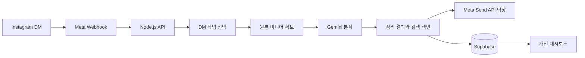

# 디미의 기술 구조와 선택 이유

2026-11-01 코드 기준. 발표·팀원 공유용이다. 아래 선택 이유는 현재 구현과 MVP 요구에 맞춰 설명한 설계 근거이며, 도구 간 성능을 모두 비교 실험했다는 뜻은 아니다.

디미는 **Instagram DM을 입력 창으로 쓰고, 콘텐츠를 읽어 실행에 필요한 정보로 정리해주는 멀티모달 비서**다. 사용자는 게시물을 공유하고 정리할 작업을 고른다. 서버가 원본 이미지·영상을 확보하고 Gemini로 분석한 뒤 DM과 개인 대시보드에 결과를 제공한다.

## 전체 흐름

일반 문장은 콘텐츠 처리 버튼 대신 Gemini 일반 대화 경로로 보낸다. 뉴스는 분석 중 외부 근거 검색 단계가 추가된다.

## 기술 스택과 이유

| 영역 | 현재 사용하는 기술 | 선택 이유 |
| --- | --- | --- |
| 프론트엔드 | HTML·CSS·JavaScript + **Preact** | 전달받은 디자인 HTML/CSS를 유지하면서 로그인 상태·필터·상세 화면을 연결하기 위해서다. 작은 렌더링 런타임을 재사용하며 PC·모바일 디자인을 같은 실제 데이터에 연결한다. |
| 디자인 빌드 | **Python 빌드 스크립트** | 디자인 HTML의 스타일·화면 상태 로직·반복/조건 마크업을 배포용 CSS·JS·템플릿으로 변환한다. 디자인 원본을 수정하고 빌드하는 작업 흐름을 유지한다. |
| 서비스 백엔드 | **Node.js 22, JavaScript ES modules** | 웹훅 수신, 인증 확인, 작업 분기, 외부 API 요청과 DM 전송을 비동기로 연결한다. 기존 HTTP 서버 로직을 Vercel 함수에서도 재사용한다. |
| 미디어 백엔드 | **Python + yt-dlp + Pillow** | 공개 Instagram 원본 정보·미디어 확보에는 yt-dlp, 이미지 방향 보정·JPEG 변환에는 Pillow를 사용한다. 이 기능들을 JavaScript로 다시 구현하지 않는다. |
| Instagram 연결 | **Meta Instagram Messaging API** | 공식 웹훅으로 DM·버튼 선택을 받고, Send API로 답장·Quick Replies·읽음·작성 중 표시를 보낸다. |
| 콘텐츠 분석 | **Gemini API** | 이미지·영상 화면·음성·본문을 한 요청에 함께 전달하고 구조화된 JSON으로 정리하기 위해서다. 별도 OCR·음성 전사 서비스를 필수 단계로 늘리지 않는다. |
| 일반 채팅 | **Gemini Flash-Lite** | 짧은 대화는 별도 경량 모델과 간결한 프롬프트로 처리한다. 최근 대화 맥락을 함께 보내되 미디어 분석과 분기한다. |
| 로그인·영구 데이터 | **Supabase Auth + PostgreSQL** | Google 로그인, 사용자와 Instagram 발신 계정의 연결, 분석 결과, 캘린더와 직접 모은 취향을 저장한다. 행 단위 접근 정책(RLS)으로 본인 데이터 접근을 제한한다. |
| 임시 파일·서버 상태 | **Vercel Private Blob** | 여러 서버리스 함수가 카루셀 원본·AI 입력을 공유하고, 암호화된 선택 티켓·최근 대화·봇 토큰 등을 보관한다. 미디어는 분석 후 삭제한다. |
| 의미 검색·추천 보조 | **OpenAI Embeddings + Decisions API** | 분석할 때 만든 색인을 다시 사용해 의미가 비슷한 항목을 찾고, 후보를 질문·관심 패턴에 따라 평가한다. 영상 원본 분석과 검색 후보 평가를 분리한다. |
| 배포 | **Vercel** | 정적 프론트와 Node·Python 함수를 한 프로젝트에 배포한다. 로컬 PC나 ngrok을 계속 켜둘 필요 없이 고정 HTTPS 주소로 웹훅을 받을 수 있다. |
| 도메인·소스 관리 | **Cloudflare DNS + GitHub + GitHub Actions** | 기존 도메인을 연결하고 코드·문서·변경 이력을 공유한다. CI에서 Windows·Ubuntu의 테스트와 빌드를 검사한다. |

프론트는 Next.js나 일반 React 프로젝트로 작성된 구조가 아니다. `public/`의 정적 페이지와 Preact 앱이 API를 호출하며, 현재 배포 설정은 `framework: null`이다. Cloudflare는 도메인 연결에 사용하며 이 앱의 API 실행 위치는 Vercel이다.

## DM 한 건이 처리되는 과정

### 1. 수신·검증·빠른 안내

Meta의 웹훅 검증 요청에는 challenge를 반환하고, 실제 이벤트는 앱 시크릿으로 요청 서명을 검증한다. 메시지 ID를 기준으로 처리 권한을 먼저 예약해 같은 이벤트의 재전달이 중복 분석·답장으로 이어지지 않게 한다.

수신 확인 후 분석은 Vercel의 `waitUntil` 작업 안에서 수행한다. 읽음·작성 중 표시와 작업 선택 안내를 보내 사용자가 분석 완료까지 무응답 상태로 기다리지 않게 한다. 이 작업은 영구 작업 큐가 아니며 함수 실행 시간 제한을 받는다.

콘텐츠 선택지는 **레시피 정리 / 팩트체크 / 일정 조회 / 맛집 정리 / 취향공간 정리 / 미용 정리**다. 버튼에는 원본 URL 대신 발신자에 연결된 무작위 티켓을 넣는다. 원본 메시지는 비공개 저장소에 암호화해 두고, 클릭 시 만료·발신자·중복 처리를 확인한다.

### 2. 원본 이미지·영상 확보

Meta 웹훅이 공유 게시물의 모든 이미지와 원본 주소를 항상 제공하지는 않는다. 서버는 DM 본문·첨부의 원본 링크를 확인하고, 필요한 경우 Graph API의 permalink 조회를 시도한다. 숫자 미디어 ID로 원본 주소를 임의 생성하지 않는다. 원본 주소가 없으면 전체 이미지를 읽었다고 처리하지 않고 원본 링크를 요청한다.

- **DM에 전체 MP4가 직접 오는 경우:** 안전한 Meta CDN 주소와 실제 MP4 바이트를 검증하고 바로 분석한다.
- **공개 원본의 영상이 정확히 하나인 경우:** Python이 yt-dlp로 기존과 같은 영상·음성 통합 MP4 주소를 확인한다. Node가 전체 파일을 메모리로 직접 받아 Gemini에 전달하고, 분석 종료 후 버퍼를 지운다. 중간 Blob 업로드·재다운로드를 생략한다.
- **이미지·여러 장·혼합 미디어·직접 전달이 불가능한 영상:** 전체 다운로드·비공개 임시 저장 경로를 사용한다. 최대 3개씩 다운로드·업로드하되 원본 순서로 결과를 모으며, 하나라도 실패하면 부분 성공으로 처리하지 않는다. 직접 MP4 다운로드가 실패하면 이 경로로 한 번 되돌아간다.

최대 10개 미디어, 영상당 20MiB, 원본 합계 80MiB 제한을 유지한다. 이미지는 EXIF 방향을 적용하고 긴 변 2048px·1.5MiB 이하 JPEG로 전달한다. 영상의 길이를 자르거나 소리를 제거하는 최적화는 하지 않는다. 전체 파일 전달이 모델의 모든 프레임·문자 인식을 보장하는 것은 아니다.

### 3. Gemini의 유형별 구조화

선택한 작업의 프롬프트에 모든 확보 이미지·영상과 본문을 함께 전달한다. 현재 콘텐츠 모델의 기본값은 `gemini-3.8-flash`, 일반 채팅 기본값은 `gemini-3.5-flash-lite`다. 운영 환경 변수로 바꿀 수 있다.

| 선택 | 정리하는 정보 |
| --- | --- |
| 레시피 | 요리명, 재료·분량, 조리 순서, 원문 수치 충돌·주의사항 |
| 일정 | 전시·팝업 또는 공모전·대외활동의 날짜, 장소, 조건, 신청 정보 |
| 맛집 | 가게별 위치, 메뉴·가격, 운영·예약·이용 정보 |
| 취향공간 | 공간별 특징, 위치, 운영·예약 정보 |
| 미용 | 미용실·시술 또는 제품 정보, 작성자 설명, 협찬 표기, 예약·구매 링크 |
| 팩트체크 | 검증할 주장, 근거, 판단과 확인 범위 |

모델 출력은 JSON을 파싱하고 공용 검증기로 검사한다. 없는 가격·시간·주소를 임의로 채우지 않고, 미용 효과나 사용감을 검증된 사실로 바꾸지 않는다. 실패하거나 해당 유형의 정보를 찾지 못한 콘텐츠는 정리 완료 카드로 저장하지 않는다.

### 4. 뉴스의 근거 확인

뉴스는 **주장 추출 → 외부 검색 → 자료 본문·초록 확보 → 근거와 주장 비교**를 수행한다. 현재 코드에는 Bing 웹·뉴스 RSS, Wikipedia, PubMed 검색이 연결돼 있다. 확보한 자료만 판단 입력에 넣고 실제 사용한 출처 링크를 답장에 포함한다. 자료가 부족하면 미확인으로 남긴다. 논문 전문을 읽지 못하고 초록만 확인한 경우 이를 구분한다.

따라서 뉴스의 참거짓 판단은 사용자의 취향 점수로 결정하지 않는다. 이 흐름은 외부 검색 결과를 모델에 제공하는 검색 증강 방식이며, 모든 답변이 자동으로 검증된 진실이라는 보장은 없다.

### 5. 저장과 결과 전달

구조화 결과는 기존 `factchecks` 행과 유형별 데이터에 저장한다. 일부 유형은 `reason`의 버전 있는 JSON 봉투, 맛집은 별도 관계형 테이블을 사용한다. 대시보드는 같은 결과를 PC·모바일 상세 카드로 변환한다.

기본 옵션인 **DM에서 전체 보기**는 분석 결과를 먼저 보낸 뒤 검색 임베딩·결과·대화 기록 저장을 이어서 완료한다. 사용자가 개인 링크 방식을 골랐다면 저장한 ID로 `/items/fc<ID>` 링크를 만들어 보낸다. 이 페이지는 로그인한 본인에게만 열린다. 일부 DM 전송이 실패해도 완료한 분석 결과는 보존하고 발송 상태를 미완료로 남긴다.

분석 파일은 성공·실패가 확정된 뒤 지운다. 단일 MP4 직접 경로는 메모리 버퍼를 지우고, 임시 저장 경로는 해당 작업의 비공개 원본·변환 파일을 정리한다.

## 검색과 취향 데이터

Gemini는 콘텐츠를 분석하면서 설명·근거 있는 태그·음식/장소 등의 개체·확인된 속성·확인 범위로 구성된 `contentIndex`를 함께 만든다. 검색이나 취향 추정 때 원본 영상을 매번 다시 분석하지 않도록 이 색인을 재사용한다.

- **검색:** 텍스트 일치와 OpenAI `text-embedding-3-small`의 256차원 임베딩 유사도로 후보를 만들고, Decisions API(`gpt-6-luna`)로 후보의 관련성을 평가하도록 연결돼 있다. 외부 평가를 사용할 수 없으면 기존 색인 점수로 동작한다. 현재 검색 범위는 본인의 최근 완료 결과 200건이며, 임베딩은 결과 JSON에 저장하고 서버에서 유사도를 계산한다. 별도 pgvector 인덱스를 구축한 구조는 아니다. [OpenAI 공식 Embeddings 문서](https://developers.openai.com/api/reference/resources/embeddings/methods/create), [Decisions 문서](https://developers.openai.com/api/reference/resources/decisions/methods/create)
- **관심 추정:** 공유 콘텐츠의 반복되는 특징을 약한 관심 신호로 모은다. 공유했다는 이유만으로 좋아한다고 확정하거나 성격·건강 등의 민감정보를 추정하지 않는다. 현재 자동 관심 집계는 레시피·전시 중심이고 모든 분류로 확장된 것은 아니다.
- **내 취향 궤도:** 사용자가 직접 모은 콘텐츠 목록이다. 자동 관심 추정과 별도로 저장·동기화하며 레시피·전시/공간·공모전·맛집 네 그룹을 표시한다.

API 연결 코드가 있다는 사실과 추천 품질이 검증됐다는 사실은 구분한다. 이 문서 작성 중 검색·추천용 유료 API 호출을 추가로 수행하지 않았다.

현재 화면에서는 검색창의 **돋보기 또는 Enter**가 의미 검색 API를 호출한다. 타이핑 중에는 로컬 색인으로 필터링한다. 내 취향 탭에서도 관심·추천 후보를 요청하지만, 현행 궤도 디자인은 직접 모은 콘텐츠를 표시하므로 Decisions 추천 순위가 별도 영역으로 뚜렷하게 노출되는 상태는 아니다.

## 로그인과 Instagram 연결

사용자는 Supabase Auth의 **Google 로그인**으로 서비스 계정을 만든다. 이어 Instagram 핸들을 입력하고 발급된 영문·숫자 6자리 코드를 봇에게 DM으로 보낸다. 서버는 DM의 실제 발신 계정을 확인하고 입력 핸들과 일치할 때 계정을 연결한다.

운영 봇의 Meta 권한·토큰 설정과 일반 사용자의 계정 연결은 별도 흐름이다. 일반 사용자의 가입을 위해 각자 봇 관리자용 Meta 권한을 설정하게 하지는 않는다. 브라우저에는 공개용 Supabase 키만 제공하고, 서버 비밀키·Meta/Gemini/OpenAI 키는 서버 환경에 둔다. 입력 자료 속 명령은 모델의 시스템 지시로 취급하지 않는다.

## 구현 파일과 남은 범위

| 위치 | 책임 |
| --- | --- |
| `frontend/`, `scripts/build-dashboard.py`, `public/js/dashboard-runtime.js` | 디자인 원본·빌드·Preact 렌더링 |
| `api/instagram.mjs`, `server.mjs` | Meta 웹훅·서명 확인·빠른 안내·답장·중복 방지 |
| `content-choices.mjs`, `dm-assistant.mjs` | 작업 선택 티켓·일반 대화·유형별 분기 |
| `instagram-source.mjs`, `api/media.py`, `scripts/`, `media-pipeline.mjs` | 원본 주소·미디어 확보·임시 입력·삭제 |
| `recipe.mjs`, `contest.mjs`, `exhibit.mjs`, `restaurant.mjs`, `space.mjs`, `beauty.mjs`, `factcheck.mjs` | 유형별 Gemini 분석과 결과 계약 |
| `supabase-state.mjs`, `member-data.mjs`, `supabase/migrations/` | 영구 저장·회원별 캘린더·직접 모은 취향·접근 정책 |
| `content-index.mjs`, `api/content-search.mjs`, `openai-decisions.mjs` | 공용 색인·검색·관심 집계·선택적 외부 평가 |
| `vercel.json`, `.github/workflows/` | 실행·라우팅·보안 헤더·CI |

현재 앱은 테스트/시연 목적의 개발 모드를 유지한다. 공개 서비스용 Meta 검수·권한·메시지 발송 자격은 별도로 확인해야 한다. 원본 주소가 빠진 공유의 전체 이미지 확보 제한, 실행 시간 제한과 영구 작업 큐 부재도 남아 있다. **캘린더 일정 저장은 연결됐지만 예약 DM 리마인드 작업자는 아직 없다.** 캘린더·취향 연동 계약은 [백엔드 전달 문서](calendar-taste-backend-handoff.md), 실제 속도 검증은 [지연 분석 문서](dm-latency.md)를 참고한다.

이번 검증에서는 단일 릴스의 AI 입력 준비가 9.4초 → 4.0초로 줄었고 영상 전체 파일의 바이트와 해시가 일치했다. 다중 미디어는 별도 게시물에서 이미지 7장·영상 1개의 준비 단계 44.6초 → 19.4초를 확인했다. 모두 한 건씩의 준비 단계 비교이며 Gemini 분석·실제 전체 DM 응답 시간의 개선율은 별도 측정이 필요하다.
